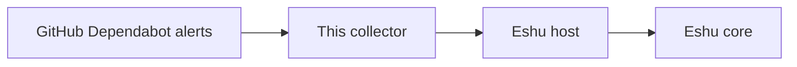

# eshu-collector-security-alerts

Status: pre-release. Please don't rely on it in production yet.

Dependabot already watches your repositories for packages with known flaws. This collector reads those alerts for one repository, or across one organization, and hands Eshu a checked summary of what's currently flagged. It only ever reads GitHub. Dismissing or fixing an alert is still a human's job, in GitHub.

What you get:

- Dependabot alerts for one allowlisted repository, or fanned out per repository across an organization
- Each alert as one typed fact, with cleaned addresses and a note on how complete the read was
- A freshness digest on every fact, so Eshu can spot work it has already done
- Tokens by environment reference or minted fresh by the host, never written into config
- No writes to GitHub, ever. No dismissals, no comments, no setting changes

Reach for it when Eshu needs current Dependabot alert state for repositories you name, read on a schedule Eshu controls. Skip it for code-scanning or secret-scanning alerts, for fixing anything, or as a general GitHub API tool.

## How Eshu runs it

The host starts the program for one claim at a time.
It sends one bounded `collector-sdk/v1alpha1` request on stdin and reads one result from stdout.
One activation serves exactly one alert feed, so add an activation per feed you want.
Then the host validates the result and commits it, and the collector stores nothing itself.

In other words, there's no long-running service to babysit here.
You enable it, Eshu calls it claim by claim, and each call either
comes back with checked facts or with a plain explanation of why not.
If that loop is new to you, the concepts page in the table below
walks through one claim from start to finish.

## Documentation

Start at the [documentation index](docs/README.md) if you'd like a map, or jump straight to what you need:

| Guide | What you will find |
| --- | --- |
| [Getting started](docs/getting-started/README.md) | The fastest honest path from a fresh checkout to something working |
| [Concepts](docs/concepts/README.md) | What it collects, how a claim plays out, and a worked example from the fixtures |
| [Guides](docs/guides/README.md) | Seeding, operating, and troubleshooting, plus how releases work |
| [Configuration reference](docs/reference/configuration.md) | Every config key, credentials, and the size limits |
| [Fact kinds reference](docs/reference/facts.md) | Every fact kind it can return, mirroring the manifest |
| [Architecture](docs/architecture/README.md) | Where it sits inside Eshu, what it's made of, and the versions it pins |
| [Diagrams](docs/diagrams/README.md) | System context, claim lifecycle, and deployment, each with a text version |
| [Examples](examples/README.md) | The real sample files in this repo and what each one is for |

## Related projects

- [Eshu core](https://github.com/eshu-hq/eshu) runs this collector and owns the final say on what's stored.
- [eshu-sdk](https://github.com/eshu-hq/eshu-sdk) holds the shared collector and fact-schema modules.
- [eshu-deploy](https://github.com/eshu-hq/eshu-deploy) has deployment examples you can copy from.

## Development

Run `make ci` and you're running the same lint, test, and race checks that CI runs.
The [contributing guide](docs/contributing/README.md) covers setup in a bit more detail,
including the tools you'll want installed first.

## Contributing, security, and license

Contributions are welcome. Please read [CONTRIBUTING.md](CONTRIBUTING.md) first, and keep credentials as environment references, never inline values. If you spot a security issue, please don't file it as a public issue. Reach the maintainers privately so a fix can land before details circulate. Source files carry SPDX MIT license headers. See [CONTRIBUTING.md](CONTRIBUTING.md) for the project rules.
